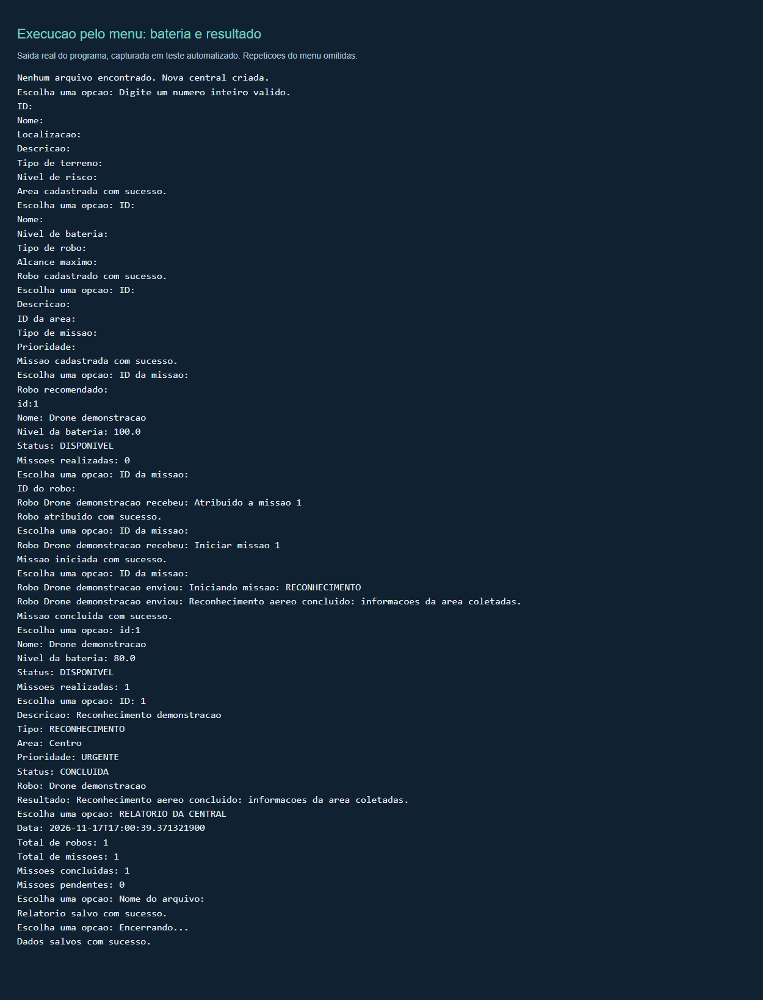
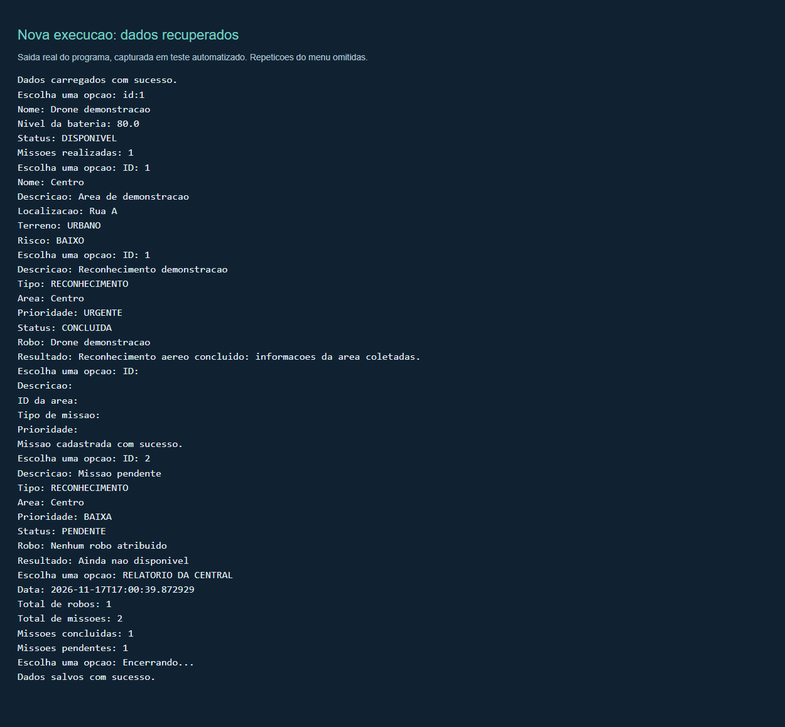

# Sistema de Coordenação de Robôs para Missões de Resgate

## Relatório técnico - Trabalho Final de POO | 2026/02
Versão revisada em 17/11/2026. Aplicação de console, sem robôs físicos, mapas reais ou serviços externos.

## Identificação a preencher pelo grupo
Integrantes: [preencher nomes e matrículas]. Turma: [preencher]. Professor(a): [preencher]. Cada integrante deve revisar esta versão e a reflexão sobre IA antes da entrega.

## Objetivo e funcionamento
A central cadastra áreas e robôs, registra missões, recomenda um robô compatível, reserva o equipamento, inicia e executa a simulação, registra o resultado e preserva os dados para a próxima execução. O histórico é a coleção de missões, consultável pelo menu, com estado, responsável e resultado.

## Organização e POO
Robo é uma classe abstrata que concentra identificação, bateria, estados, comunicação e validações. Drone e RoboTerrestre herdam esses dados e sobrescrevem a execução, a compatibilidade e o consumo. Referências do tipo Robo são usadas pela central para chamar comportamentos específicos das subclasses (polimorfismo). Comunicavel define o contrato de mensagens. Campos privados, getters e métodos de operação promovem encapsulamento; exceções impedem operações inválidas.

## Pacotes
ambiente: áreas; robos: superclasse e especializações; missoes: missão e relatório; controle: coordenação e interface; enums: estados e categorias; persistencia: arquivos. Main inicializa o sistema e App apresenta o menu.

# Coleções, persistência e regras de estado

## Coleções e justificativas
HashMap<Integer, Robo> e HashMap<Integer, AreaOperacao> indexam cadastros por ID e permitem detectar duplicações. ArrayList<Missao> preserva o histórico em ordem de registro. Queue<Missao>, implementada por LinkedList, mantém as missões pendentes em ordem de chegada (FIFO). Set<Integer>, implementado por HashSet em Robo, impede que a mesma missão seja contabilizada novamente pelo robô. As consultas devolvem cópias das listas; os objetos retornados continuam sendo os próprios objetos do domínio.

## Estados e fila
Registro cria uma missão PENDENTE e a adiciona à fila. Atribuição exige robô disponível, compatível e com bateria suficiente, e o reserva com status EM_MISSAO. A missão permanece na fila até iniciar. Início muda para EM_ANDAMENTO e remove da fila. A opção 10 executa e conclui: resultado automático, desconto de bateria, incremento do contador e estado CONCLUIDA. O robô volta a DISPONIVEL ou fica SEM_BATERIA. Cancelamento remove da fila e libera o robô. Missões concluídas e canceladas não reiniciam.

## Persistência e recuperação
PersistenciaArquivo usa ObjectOutputStream e ObjectInputStream. CentralResgate, Missao, AreaOperacao e Robo são serializáveis; as subclasses herdam essa capacidade. A serialização preserva os relacionamentos entre os objetos, a fila e os estados, permitindo continuar após reabrir. Ao sair, salva em central.dat por um arquivo temporário e substituição atômica quando suportada; a versão anterior é mantida como central.dat.bak.

## Erros de arquivos e entradas
Na primeira execução, a ausência de central.dat cria uma central vazia. Se existir um arquivo ilegível, de tipo errado ou incompatível, a aplicação encerra sem sobrescrevê-lo. O menu repete a leitura de números inválidos e mostra erros de regras de negócio. Arquivos de versões antigas das classes não têm migração automática. Relatorio utiliza streams e lambdas para contar estados e pode ser exportado em texto.

# Compatibilidade, bateria e comunicação

## Compatibilidade adotada
Drone executa reconhecimento e localização de pessoas em qualquer um dos três terrenos; não transporta suprimentos. RoboTerrestre executa localização de pessoas e transporte em terreno urbano ou irregular; não executa reconhecimento e não atua em área alagada.

## Consumo do drone
Em pontos percentuais de bateria: reconhecimento consome 20 (risco baixo), 30 (médio) ou 50 (alto); localização consome 25, 35 ou 60, respectivamente. O terreno não altera o consumo aéreo.

## Consumo do robô terrestre
O consumo é a soma de três parcelas: risco baixo/médio/alto acrescenta 5/10/15; localização/transporte acrescenta 10/20; terreno urbano/irregular acrescenta 10/20. Exemplo: transporte urbano de risco baixo consome 5 + 20 + 10 = 35 pontos percentuais.

## Limites e validações
Bateria é finita e está entre 0 e 100. Atribuição e execução verificam o consumo; bateria exatamente igual ao consumo é aceita e termina em zero, com SEM_BATERIA. Recarga vai a 100 e não ocorre durante uma missão. Manutenção é preservada durante recarga. Alcance do drone deve ser maior que zero e até 100 km; capacidade de carga fica entre 20 e 1000 kg. Peso e distância da missão não são modelados, portanto esses atributos são características cadastrais nesta versão.

## Comunicação simulada
A central chama receberMensagem ao atribuir e iniciar a missão; os robôs chamam enviarMensagem no início e no término da execução. A opção 18 permite enviar uma instrução pelo console. Mensagens são exibidas no console; não existe registro persistente de cada mensagem. A opção 17 atualiza o risco; a execução recalcula o consumo com o risco vigente e pode rejeitar se a bateria já não for suficiente.

# Funcionalidade inovadora e demonstração

## Recomendação automática de robô
A opção 8 examina os robôs disponíveis, filtra incompatíveis e os que não possuem bateria suficiente e escolhe aquele que terminaria com maior bateria restante. Em empate, prefere menor quantidade de missões realizadas, distribuindo a carga de trabalho. Persistindo o empate, escolhe o menor ID para produzir uma decisão determinística. Retorna ausência de candidato quando nenhum atende.

## O que acrescenta ao mínimo
A atribuição básica valida um par missão/robô informado pelo usuário. A recomendação compara automaticamente os candidatos elegíveis e indica uma escolha segundo critérios documentados; ela não atribui por conta própria. A prioridade fica registrada e exibida; não altera a ordenação FIFO da fila nesta versão.

## Roteiro de demonstração
Cadastrar área urbana de risco baixo (opção 4), drone com 100% e alcance 50 (5) e reconhecimento (6). Recomendar (8), atribuir (7), iniciar (9), executar/concluir (10). Consultar robô (12) e missão (14): bateria 80%, contador 1 e resultado preenchido. Exportar relatório (16), sair (0), reabrir e consultar novamente. Demonstrar uma atribuição incompatível e uma tentativa de reiniciar uma missão encerrada.

## Ambiente e reprodução
Código validado com JDK 26.0.1 e compilação --release 17. Não há dependências externas na aplicação. executar.ps1 compila e inicia; testar.ps1 compila e executa TestesSistema. O README apresenta o roteiro e a recuperação de backup. Uma nova instalação inicia vazia; os dados necessários podem ser criados durante a apresentação.

# Testes realizados e evidências

## Resultado da revisão técnica
85 verificações automatizadas passaram, sem falhas, em tests/TestesSistema.java. Foram executados também cinco cenários pelo menu, incluindo duas execuções sucessivas para validar recuperação e continuidade. Os arquivos de saída integral estão em docs/evidencias. Estes testes foram executados pela ferramenta na revisão técnica; o grupo deve repeti-los para a apresentação.

## T1 - Caso válido: reconhecimento
Entrada: área urbana de risco baixo e drone com 100%, missão atribuída e iniciada. Ação: executar/concluir. Esperado e obtido: consumo de 20, bateria final 80%, contador 1, estado CONCLUIDA e resultado automático.

## T2 - Caso inválido: incompatibilidade
Entrada: missão de reconhecimento e robô terrestre. Ação: atribuir. Esperado e obtido: IllegalArgumentException, sem atribuição; missão permanece pendente na fila.

## T3 - Caso inválido: bateria insuficiente
Entrada: drone com 19% e reconhecimento de risco baixo (20%). Ação: atribuir. Esperado e obtido: IllegalStateException; bateria e contador preservados, missão pendente e sem responsável.

## T4 - Limite e recuperação
Com 20%, o reconhecimento termina com bateria zero e SEM_BATERIA. Recarga restaura 100% e disponibilidade. Após salvar e recuperar uma central, os IDs, referências entre missão e robô, fila, bateria e contadores são preservados. Uma missão nova pode ser executada na central recuperada.

## T5 - Entradas e arquivo inválido
Texto no lugar de opção numérica é rejeitado com nova solicitação. Tentar iniciar sem robô, usar ID inexistente e reiniciar missão cancelada mostra erro. Um central.dat propositalmente inválido foi preservado byte a byte após a tentativa de abrir o programa.

# Uso de inteligência artificial e revisão do grupo

## Ferramenta e finalidade
OpenAI Codex foi utilizado para sugerir a organização dos pacotes e a divisão de tarefas, explicar interfaces e herança, revisar o código, integrar a execução, criar testes e preparar esta documentação. O grupo é responsável pela análise, compreensão e verificação do material incorporado.

## Exemplos de prompts desta conversa
“como posso fazer o executar missao”; “e se eu passase missao pra ele?”; “resolve os problemas q tao dentro do escopo q eh meu”; “olha oq ta feito e fala oq falta fazer ainda pra ficar 100%”.

## Sugestão corrigida e justificativa
Uma versão sugerida inicialmente exigia robô DISPONIVEL dentro de executarMissao. A central já o reservava com EM_MISSAO na atribuição, o que bloqueava o fluxo integrado. A revisão passou a exigir missão EM_ANDAMENTO, o próprio robô como responsável e estado EM_MISSAO. Também ligou a execução à conclusão pela central. A correção foi verificada com testes de atribuição, início e conclusão, conferindo bateria, contador e resultado.

## Reflexão a completar pelos integrantes
[Preencher com a experiência real do grupo: o que a IA ajudou a compreender, quais sugestões foram analisadas, quais conceitos precisaram estudar ou revisar e como cada integrante confirmou que compreende sua implementação. Não substituir essa reflexão por uma experiência inventada.]

## Revisão antes da entrega
Preencher identificação, revisar este texto e o UML, repetir os testes e conferir as capturas. Todos os integrantes devem saber explicar a diferença entre atribuir, iniciar e executar/concluir; os critérios de recomendação; as coleções; e a preservação dos vínculos na serialização. Os anexos seguintes contêm o UML e capturas dos registros reais de execução, renderizados sem as repetições do menu.

## UML

Diagrama completo: [UML.pdf](UML.pdf). Fonte editável: [UML.mmd](UML.mmd).
